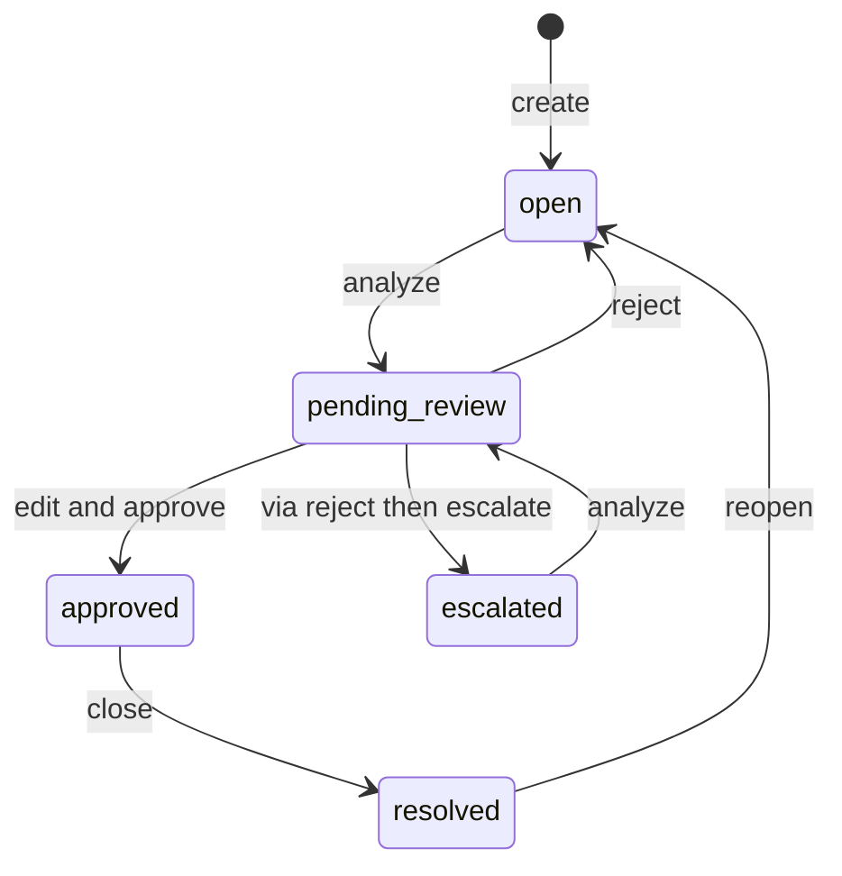

# ResolveAI technical architecture

## Domain model

- `users`: team agents/admins, salted PBKDF2 password hashes, unique emails and roles
- `documents`: user-supplied knowledge text plus source type
- `chunks`: smaller passages with parent document IDs and ordinal positions
- `tickets`: incoming request, classifier result, priority, retrieved citations, AI draft, approved response and lifecycle status
- `audit_logs`: actor, action, optional ticket reference and timestamp

Database is configured through SQLAlchemy. `DATABASE_URL=sqlite:///./resolveai.db` works immediately on a laptop; use PostgreSQL for the hosted version.

## Ticket lifecycle

The **approval boundary** matters: an LLM never calls external customer APIs or sends a message in this sample. Approval writes to the ticket record, logged with a user ID. Resolution requires an approved response.

## Draft generation

1. scikit-learn TF-IDF + LogisticRegression classifies the subject and body into `Billing`, `Technical`, `Account`, `Product`. A simple urgency rule flags high priority.
2. Knowledge docs are chunked on words with overlap (175 words, 35 overlap), stored persistently.
3. Each ticket produces a temporary TF-IDF vocabulary over document chunks and ticket text. Cosine similarity selects the top 3 matching excerpts with a minimum lexical similarity threshold.
4. LangGraph orders `classify → retrieve → draft` nodes. If `GEMINI_API_KEY` is configured, the draft node calls Gemini with evidence and instructions to avoid inventing actions; otherwise it produces an extractive draft from the strongest source.
5. The proposed draft and supporting citations are persisted with the ticket, awaiting editing and human approval.
6. The reviewer edits text before approving or rejects it. Approvals, status changes, and document changes generate audit log entries.

## API overview

| Endpoint | Method | Purpose | Permission |
| --- | --- | --- | --- |
| `/api/health` | GET | Server status | Public |
| `/api/auth/bootstrap` | GET | First-run setup flag | Public |
| `/api/auth/register` | POST | Create first admin; optionally later registration | Public, limited |
| `/api/auth/login` | POST | Issue expiring JWT | Public |
| `/api/auth/me` | GET | Current user | Authenticated |
| `/api/admin/users` | GET, POST | List/create users | Admin |
| `/api/tickets` | GET, POST | Search/list/create and auto-analyze tickets | Agent/admin |
| `/api/tickets/{id}` | GET | Ticket detail | Agent/admin |
| `/api/tickets/{id}/analyze` | POST | Generate or regenerate an AI draft | Agent/admin |
| `/api/tickets/{id}/approve` | POST | Persist approved response | Agent/admin |
| `/api/tickets/{id}/reject` | POST | Discard draft | Agent/admin |
| `/api/tickets/{id}/status` | PATCH | Escalate, resolve, reopen | Agent/admin |
| `/api/documents` | GET, POST | List/add knowledge | Agent/admin |
| `/api/documents/upload` | POST | TXT/MD/PDF ingestion | Agent/admin |
| `/api/documents/{id}` | DELETE | Delete knowledge | Admin |
| `/api/analytics` | GET | KPI and charts | Agent/admin |
| `/api/ml/evaluation` | GET | Baseline train/test report | Agent/admin |
| `/api/audit` | GET | Recent activity | Agent/admin |
| `/api/demo/seed` | POST | Insert invented sample content | Admin, demo mode |

## Reliability and production hardening backlog

- Switch model inference and document extraction to background jobs with bounded worker concurrency.
- Per-workspace tenant isolation; real invite-by-email; organization level policy enforcement.
- Migrations with Alembic, backup/restore verification and encrypted connections.
- Rate limit login/registration/upload operations, use secure HttpOnly cookies and MFA, rotate secrets.
- Signed upload storage, PDF malware scanning and extension/content checks, and upload size limits at reverse proxy.
- Separate model benchmarking sets from training; macro-F1, calibration, low-confidence deferral, class error investigation and dataset provenance.
- Groundedness, relevance, answer correctness, citation precision/recall metrics using a curated knowledge QA benchmark.
- Observability traces, PII redaction, alerting and cost monitoring.
- Test prompt injection resilience against hostile retrieved text and malicious ticket messages.
- Optional outbound integrations must be opt-in, scope-restricted, logged and require explicit consent.
