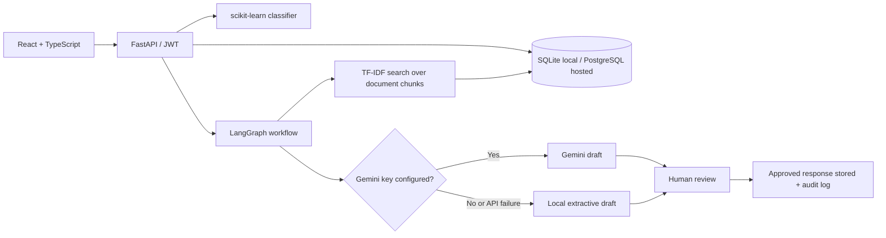

# ResolveAI - Enterprise Support Copilot (portfolio edition)

**A runnable full-stack, human-in-the-loop customer support operations app.** Built with FastAPI, SQLAlchemy, React/TypeScript, scikit-learn, and LangGraph. Uses local TF-IDF search and an extractive draft generator by default; optionally calls Gemini if you set an API key. **No external message or account action is ever taken by the AI.**


## Features

- Email/password authentication and role-based accounts (first registered user = admin; administrators can create agents)
- Ticket inbox with search, categories, priority, status and detail view
- ML ticket-intent classifier, training/evaluation endpoint, held-out synthetic demo metrics
- Document ingestion: TXT, Markdown, and text-based PDFs (max 5 MB per file and 100,000 extracted characters)
- Zero-cost TF-IDF passage retrieval with scored document citations (no external embeddings bill)
- **LangGraph** pipeline: `classify → retrieve → draft`; equivalent deterministic fallback for package-less test environments
- Gemini API **optional** for generating natural-language drafts; safe extractive/local fallback without API key
- Editable drafts, explicit human approval/rejection, escalation, resolution, reopen and copy-to-clipboard
- Dashboard KPIs, 7-day activity chart, category analytics, model evaluation and audit log
- Admin-managed team accounts; sample demo policies and example tickets
- Dockerfile, automated pytest tests and GitHub Actions workflow

## Architecture



### What is real vs simplified?

| Capability | Current implementation | Sensible next improvement |
| --- | --- | --- |
| Classification | Real scikit-learn classifier on **64 synthetic training examples**; 25% held out in evaluation | Train on a larger licensed, real labeled dataset; error analysis and calibrated confidence |
| Retrieval | Real local TF-IDF cosine-similarity across persistent text chunks | Add embeddings, pgvector, reranking and robust evaluation |
| Agent orchestration | Actual LangGraph state graph when dependencies installed | Conditional routing, tools, retries and durable queues |
| Answer generation | Optional Gemini REST integration; otherwise extractive, source-linked template | Groundedness evaluation and prompt-injection tests |
| Approvals | Fully functional; human reviews/edits before storing final text | External ticket/email connector with explicit permission and delivery status |
| Auth | Salted PBKDF2 passwords, expiring JWT, admin/agent roles | HttpOnly cookies, account recovery, MFA, rate limiting, secure invitations |
| Observability | Persistent action audit log, dashboard counters, API logs | OpenTelemetry/Langfuse, tracing, latency and token-cost instrumentation |
| Deployment | Render free API/static site + Neon free PostgreSQL | Managed secrets, backups, migrations, scalability and security audit |

**Important:** Classifier scores on tiny synthetic data do **not** establish production performance. The UI labels this explicitly. No actual email is sent when you click **Approve**.

## Run on Windows

Install **Python 3.11–3.13**, **Node.js 20+**, and Git if using GitHub. Unzip the project somewhere such as `C:\\Projects\\resolveai`.

### Terminal 1 - Backend (PowerShell)

```powershell
cd C:\Projects\resolveai\backend
py -m venv .venv
.\.venv\Scripts\python.exe -m pip install -r requirements.txt
Copy-Item .env.example .env
.\.venv\Scripts\python.exe -m uvicorn app.main:app --reload --port 8000
```

The `backend/.env` file defaults to local SQLite, so you **do not need to install PostgreSQL or Docker**. Database tables are created automatically. Visit:

- Health check: http://localhost:8000/api/health
- Interactive Swagger API docs: http://localhost:8000/docs

### Terminal 2 - Frontend (PowerShell)

```powershell
cd C:\Projects\resolveai\frontend
npm install
Copy-Item .env.example .env
npm run dev
```

Open **http://localhost:5173**. On the very first visit, **create your own administrator account** (password must be 10+ characters). After login, click **Load demo data** to create six example policies and seven example tickets. Browse support tickets, open a ticket, edit a draft and approve it. You can also upload your own TXT/MD/text PDF and create new tickets.

> If `py` isn't recognized, use `python`. If you install dependencies in a Python virtual environment, run `python -m ...` using that environment's Python executable. Do not publish your `.env`, tokens, or real customer details to GitHub.

### macOS / Linux

```bash
cd resolveai/backend
python3 -m venv .venv
source .venv/bin/activate
pip install -r requirements.txt
cp .env.example .env
uvicorn app.main:app --reload --port 8000
```

In a second terminal:

```bash
cd resolveai/frontend
npm install
cp .env.example .env
npm run dev
```

### Useful commands

```bash
# Backend tests (run from backend/, with venv active):
pip install -r requirements-dev.txt
pytest -q

# Frontend build (run from frontend/):
npm run build

# The classifier evaluation is also available to a logged-in admin or agent at:
# GET /api/ml/evaluation
```

## Train your own ML model (optional, recommended for your portfolio)

The baseline classifier is **real scikit-learn** but trained on a very small synthetic dataset. To demonstrate stronger ML skills, collect a **licensed, properly labeled** dataset with columns `text` and `label`, then:

```powershell
# In backend/, after installing the Python dependencies:
.\.venv\Scripts\python.exe train_model.py --example-csv labeled_examples.csv
.\.venv\Scripts\python.exe train_model.py --csv labeled_examples.csv --output models/intent.joblib
```

The first command makes a synthetic sample CSV. Replace/add representative cases rather than using those 64 examples as a real benchmark. The trainer splits stratified data into train/test, prints held-out accuracy, writes a classification report (`models/intent.joblib.metrics.json`), and finally fits the exported model on all labeled rows. Set `ML_MODEL_PATH=models/intent.joblib` in `backend/.env` and restart. The API and dashboard then use the loaded model plus its saved evaluation report. **Only load your own trusted joblib artifacts**; loading untrusted joblib files can execute code. The platform label set should match the training data for meaningful categorization.


## Project structure

```text
resolveai/
├── README.md / DEPLOY_FREE.md / ARCHITECTURE.md
├── .github/workflows/ci.yml
├── render.yaml                       # optional Render backend blueprint
├── backend/
│   ├── Dockerfile
│   ├── requirements.txt / requirements-dev.txt
│   ├── train_model.py                # train a new intent classifier
│   ├── .env.example
│   ├── app/
│   │   ├── main.py                   # HTTP API and workflows
│   │   ├── core.py                   # auth, database and config
│   │   ├── models.py / schemas.py
│   │   ├── ml.py                     # sklearn training and evaluation
│   │   ├── rag.py                    # document chunking and retrieval
│   │   └── agent.py                  # LangGraph AI draft pipeline
│   └── tests/
│       ├── conftest.py
│       └── test_api.py
└── frontend/
    ├── package.json / vite.config.ts / tsconfig.json
    ├── .env.example
    ├── index.html
    └── src/
        ├── App.tsx                   # dashboard + ticket workflow UI
        ├── main.tsx
        └── style.css
```

License: MIT. All sample policies/tickets bundled here are invented for the demo.
